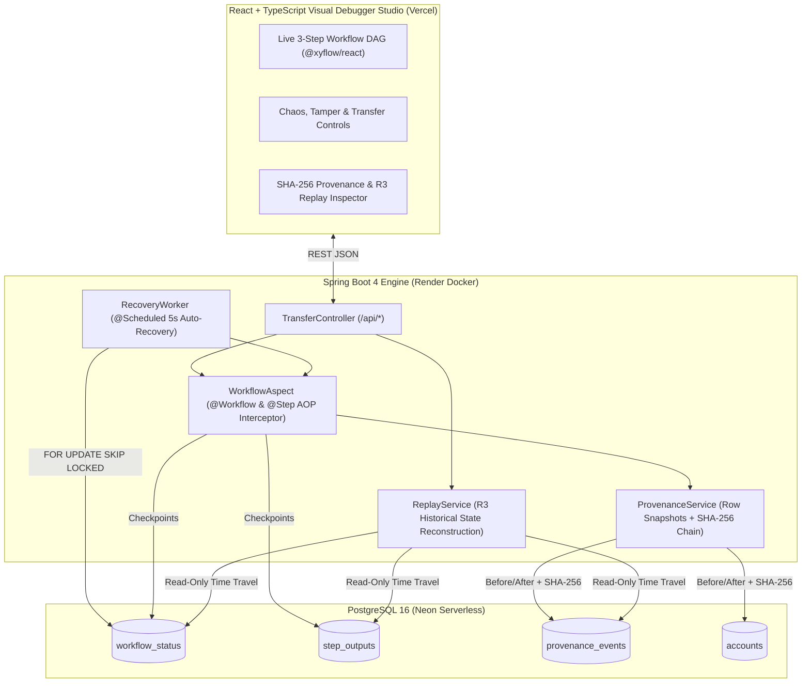

# DBOS-Spring: Crash-Proof Workflow Engine, Cryptographic Provenance & Time-Travel Debugger

**Live Interactive Studio:** [https://dbos-spring.vercel.app](https://dbos-spring.vercel.app)

> **Inspired by MIT & Stanford University's [DBOS / Apiary](https://dbos-project.github.io/), R3 Time-Travel Replay, and Epoxy Research.**

---

## 1. Executive Summary
**DBOS-Spring** is a database-native distributed workflow engine, row-level data provenance tracker, and deterministic time-travel debugger built with **Java 25, Spring Boot 4, PostgreSQL 16, and React/TypeScript**.

Instead of relying on heavyweight external orchestrators (like Temporal, Airflow, or Kafka), DBOS-Spring uses **PostgreSQL ACID transactions** as the single source of truth to provide three core guarantees:
1. **Exactly-Once Step Execution (`@Workflow` & `@Step`):** Automatically checkpoints every atomic step in PostgreSQL. If a server crashes mid-flight, a background recovery worker (`SELECT ... FOR UPDATE SKIP LOCKED`) resumes the workflow from the exact point of failure without double-charging or repeating completed side effects.
2. **Tamper-Evident Row-Level Provenance:** Captures `before` and `after` JSON snapshots of every mutated database row inside the same ACID transaction, chaining records together via a **SHA-256 cryptographic hash chain** (`prev_hash -> curr_hash`) to detect unauthorized database edits.
3. **R3 Time-Travel Sandbox Replay:** Reconstructs historical database states prior to any past workflow execution and deterministically replays the business logic in an isolated sandbox without mutating live production balances.

---

## 2. Try the Live Demo (`https://dbos-spring.vercel.app`)
*(Note: The backend runs on Render's free tier—if the dashboard says `Loading DBOS Engine State...` on first visit, give the container ~30–50 seconds to wake up.)*

1. **Safe Execution:** Click **Transfer $100 (Safe)** to execute the 3-step money transfer (`Deduct Sender` -> `Fraud Check` -> `Credit Receiver`) and watch all three DAG nodes turn green.
2. **Chaos Engineering & Auto-Recovery:** Click **Transfer $100 (Simulate Mid-Flight Crash)**. Step 1 deducts $100 from Alice, and the server immediately throws a simulated crash exception before Step 2. Watch the DAG highlight the crash in red—then wait **5 seconds** as the PostgreSQL background recovery worker automatically wakes up, skips Step 1 using its saved checkpoint, and completes Steps 2 and 3.
3. **Cryptographic Tamper Detection:** Click **Simulate DB Hack** in the top-right header to secretly alter a historical row in PostgreSQL (`provenance_events`). The SHA-256 verifier immediately switches from `INTEGRITY_VERIFIED` to `TAMPER_DETECTED` and pinpoints the exact compromised event.
4. **R3 Time-Travel Replay:** Click **Replay in Sandbox** on any historical workflow to reconstruct the exact pre-workflow account balances and verify 100% deterministic replay accuracy.
5. **Reset State:** Click **Reset System** at any time to restore Alice and Bob to `$1000` each and clear tampered logs.

---

## 3. System Architecture



---

## 4. Technology Stack

* **Language & Runtime:** Java 25 (Eclipse Temurin)
* **Backend Framework:** Spring Boot 4.1.2 (Spring Web, Spring JDBC, Spring AOP / AspectJ, Scheduling)
* **Database:** PostgreSQL 16 (Neon Serverless in production, Docker Compose locally)
* **Frontend Studio:** React 19, TypeScript, Vite, React Flow (`@xyflow/react`), Lucide Icons
* **Cloud Infrastructure:** Vercel (Frontend), Render Docker Web Service (Backend), Neon (Managed PostgreSQL)

---

## 5. Database Schema Blueprint

* **`workflow_status`**: Tracks top-level workflow execution state (`workflow_id`, `workflow_name`, `status` [`PENDING` | `COMPLETED`], `input_json`, `created_at`, `updated_at`).
* **`step_outputs`**: Stores idempotent step checkpoints (`workflow_id`, `step_id`, `step_name`, `output_json`, `completed_at`).
* **`provenance_events`**: Append-only cryptographic audit log (`event_id`, `workflow_id`, `step_id`, `table_name`, `row_key`, `op_type`, `before_json`, `after_json`, `prev_hash`, `curr_hash`).
* **`accounts`**: Reference banking workload (`username`, `balance`) seeded with `alice` ($1000) and `bob` ($1000).

---

## 6. Project Structure

```text
dbosspring/
├── Dockerfile                          # Multi-stage Java 25 production build for Render
├── docker-compose.yml                  # Local PostgreSQL 16 container
├── pom.xml                             # Maven dependencies (Spring Boot, JDBC, AspectJ)
├── src/main/resources/
│   ├── application.yml                 # Cloud & local datasource configuration
│   └── schema.sql                      # Auto-initialized database tables & seed data
├── src/main/java/com/example/dbosspring/
│   ├── engine/                         # REUSABLE CORE ENGINE
│   │   ├── annotation/                 # @Workflow and @Step annotations
│   │   ├── context/                    # ThreadLocal WorkflowContext tracker
│   │   ├── aspect/                     # WorkflowAspect checkpointing interceptor
│   │   ├── recovery/                   # RecoveryWorker background crash recovery
│   │   ├── provenance/                 # ProvenanceService SHA-256 hash chain & verifier
│   │   └── replay/                     # ReplayService R3 time-travel sandbox engine
│   └── demo/                           # REFERENCE APPLICATION
│       ├── TransferWorkflowService.java# 3-step money transfer with crash switch
│       └── TransferController.java     # REST endpoints for transfers, verify, tamper & replay
└── frontend/                           # React + TypeScript Visual Debugger Studio (Vercel)
```

---

## 7. Running Locally

### Prerequisites
* **Java 25** (or Java 21+)
* **Docker Desktop**
* **Node.js 20+**

### 1. Start PostgreSQL & Spring Boot Backend
```powershell
docker compose up -d
./mvnw spring-boot:run
```
The backend will start at `http://localhost:8080` and automatically initialize `schema.sql`.

### 2. Start the React Visual Debugger Studio
```powershell
cd frontend
npm install
npm run dev
```
Open `http://localhost:5173` in your browser.

---

## 8. Core API Reference

* `GET/POST /api/transfer?workflowId=tx-101&from=alice&to=bob&amount=100&crash=false` — Trigger a crash-proof transfer workflow.
* `GET /api/state` — Fetch live balances, workflow statuses, checkpoints, provenance events, and hash chain integrity status.
* `GET /api/verify` — Walk the entire `provenance_events` SHA-256 chain from `GENESIS` to verify database integrity.
* `POST /api/tamper` — Simulate an unauthorized database modification on historical provenance records.
* `GET /api/replay?workflowId=tx-101` — Reconstruct historical balances and execute a deterministic R3 sandbox replay.
* `POST /api/reset` — Reset accounts to `$1000` each and clear execution history.